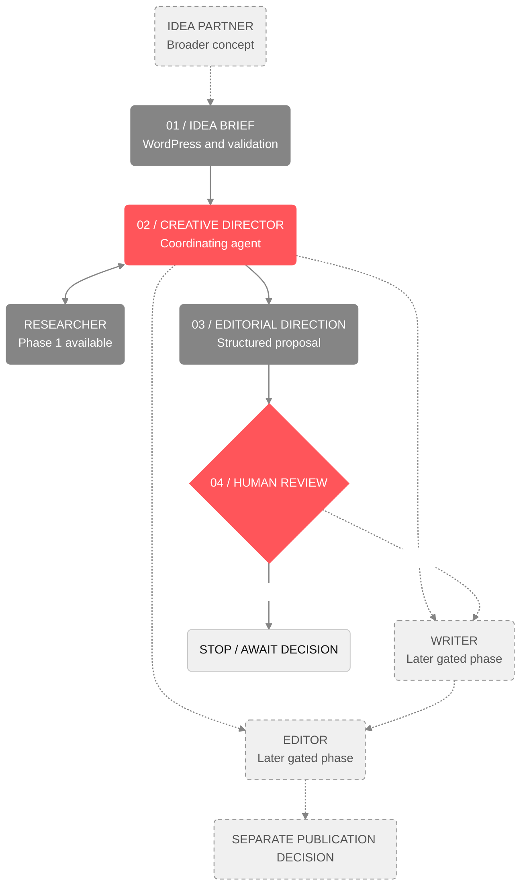

# Agent Studio

**Designing an editorial workflow where AI proposes, and people decide.**

Agent Studio is an experiment in structuring editorial work across specialized AI roles without handing editorial judgment or publication to an autonomous system. I designed the workflow, the review experience, and the integrations between a WordPress interface and n8n.

This repository is a **public technical companion**, not the production application or a copy of its private code. It contains a system diagram, design decisions, an entirely synthetic example, and a small, offline n8n demonstration. It does not connect to my WordPress site, database, model accounts, or any live webhook.

[Read the portfolio case study](https://barbarakprokop.com/productdesign/agent-studio-case-study/) · [Product design portfolio](https://barbarakprokop.com/productdesign/)

## Multi-agent architecture

One coordinating agent, three specialist roles, and a separate human decision point. Black nodes identify orchestration and approval; muted dashed paths distinguish the wider concept and later phases from the verified Phase 1 workflow.

The **Creative Director coordinates three specialist agents: Researcher, Writer and Editor**. That orchestration is the central design idea. Instead of treating editorial production as a single prompt, Agent Studio separates research, drafting and independent review into distinct responsibilities.

An **Idea Partner** shapes the initial idea in the broader product concept. It is not a separate executable agent in the archived October 2026 Phase 1 canvas.

**Solid lines** describe the verified Phase 1 direction and review path. **Dashed lines** show conceptual or later gated stages; they do not imply those stages were tested end to end. The Creative Director, Researcher, Writer and Editor nodes are present in the private n8n export, but Writer and Editor were not permitted to run during the verified Phase 1 workflow.

### Agent responsibilities

- **Creative Director:** leads editorial direction and coordinates specialist contributions.
- **Researcher:** gathers and evaluates supporting material and sources; available to the Creative Director in Phase 1.
- **Writer:** develops a draft from an approved direction; configured for a later, disabled production phase.
- **Editor:** independently critiques and reviews drafted material; also gated for later production.
- **Idea Partner:** helps develop or challenge the initial idea in the wider concept; not a distinct executable node in the archived Phase 1 n8n canvas.
- **Human reviewer:** controls whether the process proceeds. Agent output is not itself editorial approval or permission to publish.

## What is actually demonstrated here

The example is intentionally **not an AI agent implementation**. It is a small, importable n8n flow showing the surrounding product logic: a synthetic idea brief, deterministic validation, a mock structured proposal, and a blocking human approval state. No model requests, external endpoints or credentials are required.

1. Open n8n and import [`workflows/editorial-review-demo.json`](workflows/editorial-review-demo.json) into a **new workflow**.
2. Keep the workflow inactive and run it manually.
3. Inspect the output of **Stop at human review**. It should report `awaiting_human_editorial_approval` and `can_publish: false`.
4. Compare the synthetic input and expected result in [`examples/`](examples/).

The JSON was checked for structural consistency, but has **not** been executed inside a live n8n installation. Node versions or import details may vary across n8n installations.

## Design decisions

| Choice | Why it matters |
| --- | --- |
| Creative Director coordinating three specialist agents | Distinguishes orchestration, research, drafting and independent review instead of asking one prompt to do everything. |
| Structured proposal contract | A proposal can be inspected and validated before a person acts on it. |
| Deterministic state checks | Approval and publication restrictions should not depend on an AI model obeying instructions. |
| Human review before drafting | Editorial direction is something to discuss, not an implicit command to produce or publish. |
| Authenticated proxy in the private system | Keeps upstream integration credentials out of the browser. |
| Conservative failure behavior | Missing or invalid input should halt rather than silently invent data or publish. |

More detail: [Architecture and tradeoffs](docs/architecture-and-decisions.md).

## Repository contents

- [`docs/architecture-and-decisions.md`](docs/architecture-and-decisions.md): technical breakdown, scope, tradeoffs and limitations.
- [`workflows/editorial-review-demo.json`](workflows/editorial-review-demo.json): synthetic offline n8n demonstration.
- [`examples/idea-brief.json`](examples/idea-brief.json): invented input data.
- [`examples/expected-review.json`](examples/expected-review.json): example review state.
- [`SECURITY.md`](SECURITY.md): what is excluded and what this example must not be used for.

## Status and boundaries

**Documented source:** a private Phase 1 Agent Studio snapshot from October 2026, with a working Creative Director path and human editorial review. Later stages are not presented here as tested or shipped features. This public repository is a teaching and portfolio artifact, not a production service and not a promise of end-to-end automation.

**Built and documented by Barbara K. Prokop** · [Portfolio](https://barbarakprokop.com/productdesign/) · [LinkedIn](https://www.linkedin.com/in/barbarakprokop/)
